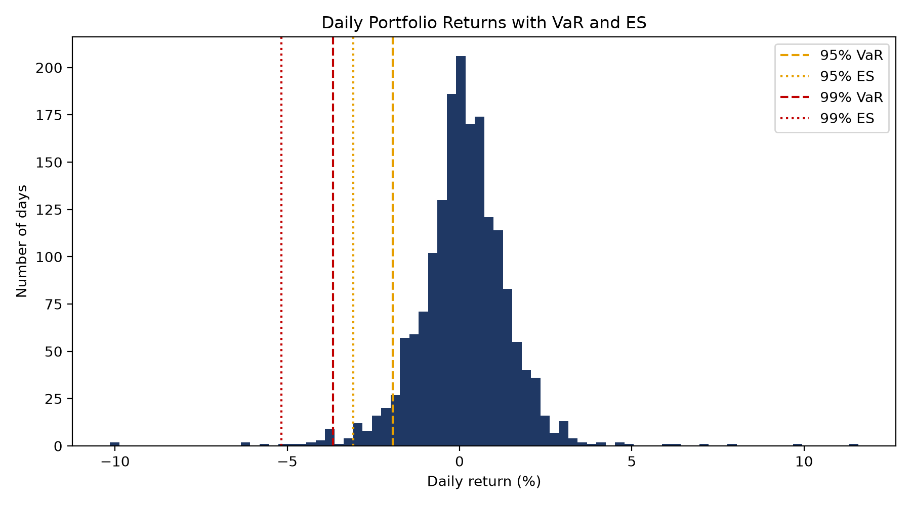
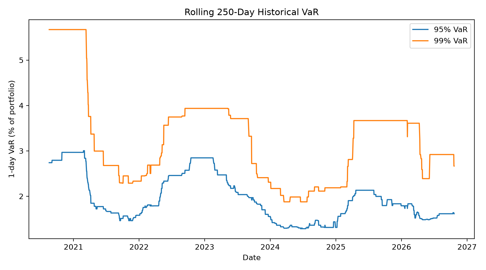

# Portfolio Risk Calculator: Historical VaR and Expected Shortfall

Python tool that measures 1-day market risk for a multi-asset portfolio of any stocks, ETFs, or indexes using historical simulation.

Built with AI assistance (Claude) as a learning project. I chose the portfolio, ran the analysis, and wrote up the results.

## What it does
- Asks for your tickers and weights
- Downloads daily adjusted prices (Yahoo Finance via `yfinance`)
- Computes daily returns for each asset and for the weighted portfolio
- Calculates 1-day **VaR** and **Expected Shortfall (ES)** at 95% and 99%
- Plots the return distribution and a rolling VaR

## Requirements
Python 3.10 or newer.

## Install
Open a terminal in the project folder (the one that contains `requirements.txt`), then run:

Windows:
```bash
py -m pip install -r requirements.txt
```

Mac / Linux:
```bash
python3 -m pip install -r requirements.txt
```

## Run it
Run from the same folder as the script.

Windows:
```bash
py var_calculator.py
```

Mac / Linux:
```bash
python3 var_calculator.py
```

You will be asked for:
1. **Tickers**, separated by commas (e.g. `SPY, TLT, ^GSPC`)
2. **Weights**, separated by commas (e.g. `50, 30, 20`), or press Enter for equal weights. Weights are rescaled to sum to 1, so percentages and fractions both work.

The two charts (`return_distribution.png` and `rolling_var.png`) are saved in the folder you ran the script from.

### Settings
Edit these constants at the top of `var_calculator.py`:

| Setting | Meaning | Default |
|---|---|---|
| `START_DATE` | First date of price history | 2019-01-01 |
| `CONFIDENCE_LEVELS` | VaR and ES confidence levels | 95%, 99% |
| `WINDOW` | Days used for rolling VaR | 250 |
| `PORTFOLIO_VALUE` | Converts percentages into amounts | 100,000 |

### Finding symbols
Search any name on [finance.yahoo.com](https://finance.yahoo.com) and copy the symbol exactly.

| Symbol | What it is |
|---|---|
| `^GSPC` | S&P 500 index |
| `^GSPTSE` | S&P/TSX Composite index |
| `^IXIC` | Nasdaq Composite index |
| `^DJI` | Dow Jones Industrial Average |
| `^FTSE` | FTSE 100 (UK) |
| `SPY`, `QQQ`, `TLT`, `GLD` | ETFs (US equities, Nasdaq-100, long Treasuries, gold) |
| `XIU.TO` | TSX 60 ETF (Toronto-listed, priced in CAD) |

## Method
- **Historical VaR:** the (1 − confidence) quantile of the portfolio's daily returns, reported as a positive loss.
- **Expected Shortfall:** the average loss on days worse than the VaR cutoff.
- **Rolling VaR:** uses only the prior `WINDOW` days for each forecast (no look-ahead).

## Example Portfolio
| Ticker | Weight |
|---|---|
| XEQT.TO | 50% |
| NDAQ | 30% |
| NVDA | 20% |

## Results
Results as of October 21, 2026, using daily data from August 14, 2019 (1,768 trading days). Amounts assume a 100,000 portfolio.

| Confidence | VaR (%) | VaR (amount) | ES (%) | ES (amount) |
|---|---|---|---|---|
| 95% | 1.94% | 1,944 | 3.08% | 3,079 |
| 99% | 3.67% | 3,673 | 5.16% | 5,164 |




On 99% of days, the portfolio lost less than 3.67%. On the worst 1% of days, the average loss was 5.16%, about 1.5 percentage points past the VaR cutoff, so the left tail is heavy. The rolling 99% VaR starts high (about 5.7%) because its first windows include March 2020. It falls sharply in early 2021 when those days leave the 250-day window, not because markets calmed down. It rises again in 2022 and in early 2025.

## Assumptions and limitations
- Past returns are representative of future risk.
- Constant weights, rebalanced daily; no transaction costs; no short positions.
- Historical VaR has no information about volatility regimes and reacts slowly to shocks.
- VaR says nothing about how bad losses are *beyond* the cutoff (ES partly addresses this).
- **Currency:** prices are used in their local currency. Mixing currencies (e.g., `^GSPC` in USD with `^GSPTSE` in CAD) ignores FX risk.
- **Calendars:** days when any asset has no price (market holidays, a later listing date) are dropped, which can shorten the sample.
- **Indexes are not tradable.** Index data is fine for measuring risk, but real portfolios hold funds or stocks.
- **Small tail samples:** 99% VaR on 5 years of data rests on only ~12 tail days, so the estimate is noisy.
- **Live data:** Yahoo Finance updates daily, so re-running the script later gives slightly different numbers.
